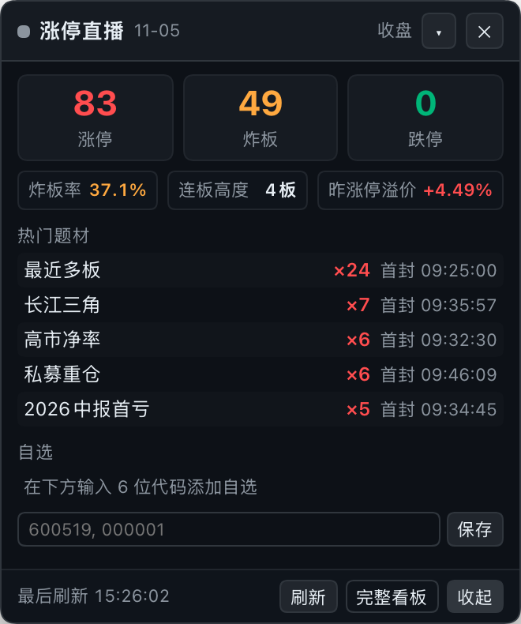

# dsh-limitup-widget — A 股涨停直播浮窗（DeepSeek Harness 插件）

[](https://www.npmjs.com/package/dsh-limitup-widget)
[](LICENSE)
[](https://github.com/deepseek-ai/deepseek-harness)

> A frame-wide floating **A-share limit-up card** for [DeepSeek Harness](https://github.com/deepseek-ai/deepseek-harness) (`dsh`).
> 在 DSH 桌面 / Web UI 的 **frame 级浮动层**（`shell.overlay`）里常驻一张深色小卡片：实时显示 A 股涨停 / 炸板 /
> 跌停家数、炸板率、连板高度、昨日涨停溢价、热门题材与自选股；Host 侧提供**同源代理**，并可探活 / 自动拉起
> 随仓库附带的 Python 看板后端。可拖动、可收起、可关闭（关闭后浮层无任何残留，可从左侧边栏底部恢复）。



---

## 1. 它是什么

本插件由 **两半** 组成，安装一个 npm 包即同时生效：

| 半 | 文件 | 职责 |
|---|---|---|
| **Client** | `lib/client.js` | 浏览器端手写模块（无构建步骤，React 由宿主提供），在 `shell.overlay` 注册 `limitup-widget` 卡片，轮询数据并渲染 |
| **Host** | `lib/index.js` | ESM cordis 插件：在 DSH webServer 上挂 `/limitup-widget` 同源前缀路由，反代本地 Python 后端；启动时探活，可选自动拉起后端 |
| **后端** | `dashboard/`（仓库内，单独维护） | Python + Flask + akshare 的 A 股涨停直播看板；默认 `http://127.0.0.1:8000`，不随 npm 包分发 |

插件本体**不采集、不上传任何用户数据**：浏览器只请求同源 `/limitup-widget/api/*`，Host 只访问
`backendUrl`（默认本机 `127.0.0.1:8000`）与本机 Python 进程。

---

## 2. 功能

### 2.1 浮动卡片内容

- **状态**：状态点 + 文案（盘中 / 午休 / 收盘 / 盘前 / 休市 / 过期 / 未连接 / 连接中），数据日 `MM-DD`
  （非当前交易日时显示「回退」标签，悬停可看回退说明）；
- **三大数字**：涨停 / 炸板 / 跌停 家数；
- **次级指标**：炸板率（`炸板 ÷ (涨停 + 炸板)`，后端给出）、连板高度（最高连板数）、昨日涨停均溢价；
- **热门题材 Top5**：题材名 × 涨停家数、最早首封时间；概念映射未建完时后端按「所属行业」兜底并标注「行业」；
- **自选股**：名称 / 代码 / 最新价 / 涨跌幅，涨停显示红色「涨停」徽章，单只获取失败显示「失败」；
- **页脚**：最后刷新时间、刷新、完整看板、收起。

### 2.2 交互

| 操作 | 行为 | 持久化（localStorage） |
|---|---|---|
| 拖动 | 按住头部拖动（4px 位移阈值区分点击与拖动；按钮/输入框上不触发） | `limitup.widget.pos` |
| 收起 | ▾ 收起为小胶囊（「涨停 N · 炸板 N」），**整颗胶囊可点击**展开 | `limitup.widget.collapsed` |
| 关闭 | 头部 ✕ 关闭整卡：浮层内**不渲染任何内容**（无小挂件残留）；左侧边栏底部出现「涨停」恢复按钮，点击恢复整卡；关闭期间轮询继续。关闭状态只在本次页面生命周期内有效，刷新/重启 DSH 后看板自动重新出现（不会永久关没） | 会话内状态 |
| 刷新 | 页脚「刷新」→ `GET /api/refresh` 强制后端刷新一次（可能耗时约 30s） | — |
| 完整看板 | 用**绝对 http 地址**在系统浏览器打开后端看板（桌面端 `dsh-app://` 下相对地址会被静默拒绝；弹窗被拦时自动复制地址并提示） | — |
| 自选 | 输入逗号 / 空格分隔的 6 位代码，保存后立即刷新 | `limitup.watchlist`（与看板页面同一 key） |

### 2.3 轮询与容错

- 轮询间隔由 Host 的 `/limitup-widget/api/config` 下发，默认 **交易时段 60s / 其余 300s**；
  页面隐藏时暂停，`visibilitychange` 回到前台立即补拉一次；
- **数据过期**：红色横幅「数据已过期：自 HH:MM 起未更新」（悬停看原因）；
- **后端未连接**：错误条 + 「重试」；
- 从未成功采集：显示「加载中…」/「暂无数据」；
- 所有服务端字符串渲染前经 `esc()` 转义（React 本身也会转义），无 `dangerouslySetInnerHTML`；
  定时器、`visibilitychange` 监听、样式标签在卸载时全部清理。

### 2.4 Host 侧同源代理

浏览器只认 `/limitup-widget` 前缀，避免 CORS / 混合内容问题：

| 路由（GET/HEAD） | 行为 |
|---|---|
| `/limitup-widget/` | 302 到 `backendUrl/`（完整看板） |
| `/limitup-widget/api/config` | 返回 `backendUrl`、`backendPageUrl`、`pollTradingMs`、`pollIdleMs`、`autostart` |
| `/limitup-widget/api/snapshot` | 反代后端 `/api/snapshot`（12s 超时） |
| `/limitup-widget/api/refresh` | 反代后端 `/api/refresh`（45s 超时） |
| `/limitup-widget/api/health` | 反代后端 `/api/health`（6s 超时） |
| 其它路径 / 非 GET·HEAD | 404 / 405 |
| 后端不可达 | 502 `{"ok":false,"error":"backend_unreachable",...}`，并限频尝试补拉后端 |

**后端自动拉起（可选）**：插件加载时探活 `backendUrl/api/health`。若健康检查失败、`autostart` 为 true 且
`script` 非空，则用 `pythonBin script` 拉起后端（环境对齐 `HOST=127.0.0.1`、`PORT`=backendUrl 端口、
`TZ=Asia/Shanghai`），最多等待 `startupTimeoutMs`；**只会在自己拉起过进程时于卸载时终止它，
已在运行的后端永远不会被插件杀掉**。

---

## 3. 安装

### 3.1 环境要求

- DeepSeek Harness `>=0.2.0-rc.2 <0.3.0`（桌面版或 Web profile），Node.js ≥ 20；
- 后端需要 Python ≥ 3.9（推荐 3.10+）与可访问东方财富数据源的网络（akshare 免费接口，无需 API key）。

### 3.2 安装插件

**方式 A：插件市场 / Settings → Plugins**（上架后推荐）

在 DSH 的 **设置 → 插件**（市场 / Discover）里搜索 `dsh-limitup-widget` 一键安装。
桌面版 profile 由 Electron 应用管理，请通过设置界面安装，不要手动改桌面 profile。

**方式 B：CLI / npm（已发布 【0.2.1】）**

```sh
# 安装到当前 profile（不用全局安装）
dsh plugin add dsh-limitup-widget
dsh plugin --profile web add dsh-limitup-widget         # 或显式指定 profile

# 从 GitHub 源码（等价，npm 不可用时）
dsh plugin --profile web add github:LusJourney/dsh-limitup-widget

# 从本地 tarball / Release 附件
dsh plugin --profile web add /absolute/path/to/dsh-limitup-widget-0.2.1.tgz
```

npm 包页面：<https://www.npmjs.com/package/dsh-limitup-widget>

安装后**重启 DSH 应用**（新 bundle 才会进入正在运行的 roster），右下角应出现「涨停直播」卡片。

> 市场索引：DSH `0.2.1+` 的 **插件 → Discover → Index sources** 可添加
> `https://cdn.jsdelivr.net/npm/dsh-plugin-catalog/index.json`，之后即可搜索到本插件。

### 3.3 准备后端（二选一）

**A. 手动运行（推荐先跑通）**

```sh
git clone https://github.com/LusJourney/dsh-limitup-widget.git
cd dsh-limitup-widget/dashboard
python3 -m venv .venv
source .venv/bin/activate            # Windows: .venv\Scripts\activate
pip install -r requirements.txt
python app.py                        # → http://127.0.0.1:8000
```

首次启动约 10–20 秒出第一版快照（概念映射在后台慢慢建，期间题材按行业兜底）；依赖与接口说明见
[`dashboard/README.md`](dashboard/README.md)。

**B. 交给插件自动拉起**

在 profile 的 `cordis.patch.yml` 里写同 id 配置（完整示例见下一节），把 `pythonBin` 指向
**后端 venv 的 python 绝对路径**、`script` 指向 **`dashboard/app.py` 绝对路径**。插件启动时若后端没起会自动拉起；
反之 `script: ''` 时只探活、不拉起（本包默认配置即如此）。

### 3.4 验证

```sh
curl -s http://127.0.0.1:8000/api/health
# 期望：{"ok":true,...}
```

重启 DSH 后，右下角出现卡片即安装成功；Host 日志里可见 `[limitup-widget] host plugin loaded`。

---

## 4. 配置

默认值在包内 `cordis.patch.yml` 的 `insert.config` 中（Host 行 `id: limitup-widget`）。
**用户覆盖方式**：在 profile 的 `cordis.patch.yml` 追加同 `id` 的 patch 条目。
⚠️ 覆盖会**替换整个 config 对象，请写全量字段**：

```yaml
- id: limitup-widget
  name: dsh-limitup-widget
  config:
    backendUrl: http://127.0.0.1:8000
    autostart: true
    pythonBin: /absolute/path/to/dashboard/.venv/bin/python
    script: /absolute/path/to/dashboard/app.py
    startupTimeoutMs: 45000
    pollTradingMs: 60000
    pollIdleMs: 300000
```

| 字段 | 默认 | 允许范围 | 说明 |
|---|---|---|---|
| `backendUrl` | `http://127.0.0.1:8000` | 任意 `http(s)` URL | 后端根地址；端口同时用于自动拉起子进程的 `PORT` |
| `autostart` | `true` | 布尔 | 探活失败且 `script` 非空时是否拉起后端 |
| `pythonBin` | `python3` | 非空字符串 | 拉起后端用的 Python（建议后端 venv 内解释器的绝对路径） |
| `script` | `''`（空） | 字符串 | `app.py` 绝对路径；为空则只探活、不拉起 |
| `startupTimeoutMs` | `45000` | 1000–300000 | 拉起后等待健康的超时 |
| `pollTradingMs` | `60000` | 15000–600000 | 交易时段客户端轮询间隔 |
| `pollIdleMs` | `300000` | 30000–3600000 | 非交易时段客户端轮询间隔 |

---

## 5. 目录结构

```
dsh-limitup-widget/
├── package.json          # dsh.bundle.patch + dsh.client(platform: web) 清单
├── cordis.patch.yml      # bundle patch：insert Host 行 limitup-widget + 默认 config
├── lib/
│   ├── index.js          # Host：/limitup-widget 路由 + 后端探活/自动拉起
│   └── client.js         # Client：shell.overlay 浮动卡片（拖动/收起/关闭/轮询）
├── tests/
│   ├── test-loader.mjs   # 假 window.__ModuleLoader__ / React：加载、注册、渲染、转义
│   └── test-node-plugin.mjs  # 假 ctx/webServer：路由映射、autostart 决策矩阵
├── assets/
│   ├── icon-180.png      # 市场图标（180×180）
│   └── screenshot-card.png
├── dashboard/            # Python 看板后端（GitHub 仓库内，不在 npm tarball 中）
├── screenshots.json      # 市场店铺截图声明
├── README.md
└── LICENSE
```

`npm pack` 生成的 tarball 只包含插件本体（`lib/`、`cordis.patch.yml`、`README.md`、`LICENSE`、`assets/`、
`screenshots.json`）；需要后端源码请从 GitHub 仓库获取 `dashboard/`。

---

## 6. 开发与验证（不启动 DSH 也能跑）

```sh
node --check lib/index.js
node --check lib/client.js
node tests/test-loader.mjs      # 假 ModuleLoader/React：加载、注册 shell.overlay、渲染、XSS 转义
node tests/test-node-plugin.mjs # 假 ctx/webServer：路由映射、autostart 决策
npm test                        # 上面两个测试
```

---

## 7. 故障排查

- **卡片不出现**：确认插件已装进当前 profile 并**重启** DSH；Host 日志有
  `[limitup-widget] host plugin loaded` 说明 Host 半已加载。浏览器 console 若报
  `slot entry crashed in 'shell.overlay'`，用 `node --check lib/client.js` 检查语法。
- **卡片显示「后端未连接」**：`curl http://127.0.0.1:8000/api/health` 应返回 `{"ok":true,...}`。
  未启动且未配置自动拉起时，手动 `python app.py`；检查 `pythonBin` / `script` 是否为绝对路径且可执行。
- **关闭后找不到卡片**：看左侧边栏底部（Settings 旁边）的「涨停」小按钮，点一下恢复；刷新窗口（Cmd+R）或重启 DSH 也会让看板重新出现；
  清除 localStorage 的 `limitup.widget.hidden` 与 `limitup.widget.pos` 后刷新页面。
- **8000 端口被占用**：改 `backendUrl`（自动拉起的 `PORT` 会取自 URL 端口），或让已有后端先运行。
- **健康检查一直超时**：首次启动 akshare 拉数据可能较慢，可调大 `startupTimeoutMs`。
  插件只在**自己拉起**进程后才会在卸载时终止它，已在运行的后端不会被杀。
- **数据过期红色横幅**：后端数据源异常 / 被限流，保留上一份好数据并标 stale；
  打开完整看板看后端日志与数据源状态。
- **完整看板点了没反应**：桌面端会用系统默认浏览器打开 `backendUrl`；普通浏览器弹窗被拦时插件会复制
  看板地址到剪贴板并提示。
- **Python 环境**：不要用 **DSH 内置 runtime 的 python** 建后端 venv（hardened runtime 签名会拒绝 pip
  安装的 C 扩展，numpy 报 *different Team IDs*）。请用系统 / Homebrew / python.org 的 Python 3.9+。

---

## 8. 数据、隐私与免责声明

- 插件只读取 DSH 前端数据并请求**同源** `/limitup-widget/*`；Host 只访问配置的 `backendUrl` 与本机 Python；
  无遥测、无第三方请求、不读取任何凭据；
- 持久化仅使用 localStorage 的 4 个 key：`limitup.widget.pos`、`limitup.widget.collapsed`、
  `limitup.widget.hidden`、`limitup.watchlist`；
- 数据来自后端通过 **akshare 免费公开接口**抓取的东方财富数据，可能存在延迟、缺失或错误；
- 本插件只做数据展示与提醒，**不构成任何投资建议**，据此交易的风险由使用者自行承担。

## 9. License

[MIT](LICENSE) © 2026 Luka Zhao (LusJourney)

---

## English summary

`dsh-limitup-widget` is a DeepSeek Harness plugin that mounts a floating A-share limit-up card in the
frame-level overlay (`shell.overlay`). It shows limit-up / broken-board / limit-down counts, break rate,
consecutive-board height, previous-day limit-up premium, the top 5 themes and a localStorage-backed watchlist.
The card can be dragged (position persisted), collapsed into a pill, or closed entirely (no floating remnant; while closed a small 涨停 restore button appears at the sidebar footer, and a refresh brings the card back)
button; all three states persist across reloads. Polling runs every 60 s during A-share trading hours and
every 300 s otherwise, pauses when the page is hidden and catches up on `visibilitychange`. The Host half
exposes a same-origin proxy under `/limitup-widget/api/*`, health-checks the backend and can optionally spawn
`python app.py` (only the child it spawned is ever stopped). The Python dashboard backend lives in the
GitHub repository under `dashboard/` and is not bundled in the npm tarball. MIT licensed.
