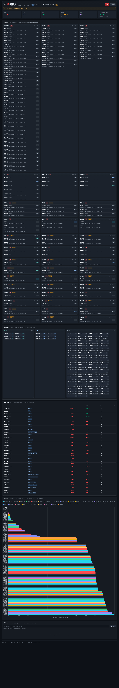

# A股涨停直播看板（单文件本地版）

本地运行的 A 股短线情绪看板：Python 单文件后端（Flask）+ 单文件前端（原生 HTML/CSS/JS + Chart.js），
数据全部来自免费 **akshare** 接口，无需任何 API key。

本目录是 [`dsh-limitup-widget`](../README.md) DSH 浮窗插件仓库自带的 Python 后端，可以单独运行，
也可以由插件 Host 侧按需自动拉起（见插件 README 的配置一节）。



```
python app.py   →   http://127.0.0.1:8000
```

---

## 1. 快速开始

需要 Python ≥ 3.9（推荐 3.10+）与可访问东方财富数据源的网络。

```bash
cd dashboard
python3 -m venv .venv
source .venv/bin/activate            # Windows: .venv\Scripts\activate
pip install -r requirements.txt
python app.py
```

然后浏览器打开 <http://127.0.0.1:8000> 。

> 首次启动时：涨停/炸板/跌停/昨日涨停数据约 10–20 秒出第一版快照；
> 概念映射在后台慢慢建（全市场约 531 个板块，每板块约 3–7 秒，**完整建完约 40–60 分钟**；
> 按板块热度从高到低抓取、每 20 个落盘一次、进程重启自动续跑，期间题材按"所属行业"兜底，
> 越跑越准；当天再次启动直接命中缓存）；自选股行情首拉较慢（全市场分页约 5–6 分钟），
> 页面会用单只行情接口在约 20–40 秒内快速补齐。
> 页面每 60 秒自动轮询，无数据时显示"暂无数据"，绝不编造。

## 2. 配置（环境变量，全部可选）

| 变量 | 默认 | 说明 |
|---|---|---|
| `PORT` | `8000` | HTTP 端口 |
| `HOST` | `127.0.0.1` | 监听地址；公网部署时设 `0.0.0.0`（务必配合限流/访问码，接口默认无鉴权） |
| `LIMITUP_DISABLE_BG` | 关 | `=1` 时不启动后台刷新/概念线程（测试用） |
| `LIMITUP_FAKE_FAIL` | 关 | `=1` 时每次拉取都抛异常（验证红色 stale 横幅，测试用） |
| `LIMITUP_ACCESS_CODE` | 空 | 设置后必须带 `?code=访问码` 才能打开（首次通过后写 Cookie，30 天免输） |
| `LIMITUP_RATE_LIMIT` | `0` | 每 IP 每分钟请求上限，`0`=不限；公网公开部署建议 `120`~`300` |
| `LIMITUP_TRUST_PROXY` | 关 | 在 Caddy/nginx 反代后面时设为 `1`，从 `X-Forwarded-For` 取真实 IP |
| `LIMITUP_REFRESH_COOLDOWN` | `10` | 每 IP 手动刷新 `/api/refresh` 冷却秒数（公网防刷） |

例：`PORT=8080 python app.py`；公网只读部署示例见 [`deploy/DEPLOY.md`](deploy/DEPLOY.md)。

## 3. 页面内容

1. **顶栏**：最后刷新时间、数据日 / 非交易日回退提示、市场阶段（盘前/盘中/午休/收盘/非交易日）、
   涨停数 / 炸板数 / 跌停数 / **炸板率 = 炸板÷(涨停+炸板)** / **连板高度**（最高连板数）/
   **昨日涨停股今日平均溢价**；手动刷新按钮；数据过期时整条红色横幅。
2. **题材榜**：涨停股按概念分组，题材按"涨停家数 → 最早首次封板时间"排序；
   卡片内股票按首次封板时间排序，显示名称/代码、连板数徽章、首次封板时间、封板资金（亿）、
   炸板次数、流通市值（亿）。概念映射未完成时用"所属行业"兜底并标注「行业口径」。
3. **连板梯队**：按连板数分列，最高板在最左。
4. **炸板股池**：名称、概念、最高涨幅、当前涨幅、炸板次数、炸板时间。
5. **时间线**：Chart.js 横向图，x 轴为首次封板时间（09:25–15:00），按题材着色。
6. **自选**：输入 6 位代码（逗号/空格分隔）或点击股票加入；保存在浏览器 `localStorage`
   （key: `limitup.watchlist`）；自选股在页面各处高亮，并显示实时价/涨跌幅/状态（涨停/跌停/普通）。
7. **告警**：请求浏览器通知权限后，页面轮询比较前后快照，触发：
   (a) 自选股**新封涨停**；(b) **连板数 ≥3** 的股票炸板；(c) **炸板率上穿 40%**。
   同时有页面内告警条 + 行高亮闪烁，同一事件不重复报。

## 4. 数据来源与口径（全部免费）

| 数据 | akshare 接口 | 要点 |
|---|---|---|
| 涨停股池 | `stock_zt_pool_em(date)` | 首次/最后封板时间、封板资金、炸板次数、连板数、所属行业、换手率、流通市值 |
| 炸板股池 | `stock_zt_pool_zbgc_em(date)` | 当前涨幅、炸板次数、首次封板时间、所属行业 |
| 跌停股池 | `stock_zt_pool_dtgc_em(date)` | — |
| 昨日涨停今日溢价 | `stock_zt_pool_previous_em(date)` | 取平均涨跌幅 |
| 自选实时行情 | `stock_zh_a_spot_em()` + `stock_bid_ask_em(code)` | 全市场分页接口慢，另用单只快照快速补齐 |
| 概念列表/成分 | `stock_board_concept_name_em()` / `stock_board_concept_cons_em(symbol=板块代码)` | 按板块涨幅排序逐板块抓，**每天缓存到 `data/`** |
| 交易日历 | `tool_trade_date_hist_sina()` | 缓存 `data/trade_calendar.json` |

一致性规则：

- **交易日与回退**：盘前（<09:25）或非交易日 → 自动取"最近一个已开盘交易日"；
  `trade_date != requested_date` 时 `is_fallback=true`，页面显示中文回退说明。
  实测东财接口在盘前传当日日期会静默返回上一交易日数据，因此日期以日历推算为准。
- **刷新时段**：北京时间 09:25–11:30、13:00–15:00 每 60 秒拉一次；其余时段只展示最后快照。
- **容错**：每个接口都独立 try/except，失败保留上一份好数据，红色横幅显示
  "数据已过期：自 HH:MM 起未更新（原因）"；从未成功则显示"暂无数据"。
- **节流**：两次 akshare 调用全局至少间隔 1 秒（跨线程），避免被数据源限流。
- **列名防御**：所有列按中文关键词映射（接口改版/列名变化不会让页面崩），未知列只记一次日志。
- **炸板池限制**：免费接口的炸板池**没有"炸板时间"字段**，页面显示 `—`（不编造）；
  "最高涨幅"用 `涨停价 / (最新价 ÷ (1+当前涨幅/100)) − 1` 推导（炸板股必然触及过涨停价），
  推导不出来时同样显示 `—`。

## 5. 数据落盘（供回测）

每次成功刷新都会向 `data/YYYYMMDD.csv`（YYYYMMDD = 数据所属交易日）追加一份快照：

```csv
timestamp,code,name,status,streak,first_seal,seal_amount,break_times,concepts
2026-11-05 00:45:19,000096,广聚能源,limit_up,1,09:25:00,423659880.00,0,
```

- `status`：`limit_up` / `broken` / `limit_down`
- `seal_amount`：单位元；`concepts`：最多 2 个热门概念，`|` 分隔
- 编码 UTF-8 with BOM（Excel 可直接打开）；同一行数 = 当日 (涨停+炸板+跌停) 数量 × 刷新次数
- 交易日/盘前回退时仍写入**数据日**的文件，便于按交易日回测

## 6. HTTP 接口

| 方法 | 路径 | 说明 |
|---|---|---|
| GET | `/` | 页面（`page.html`） |
| GET | `/api/snapshot?watch=600519,000001` | 完整快照 JSON（页面轮询用，`watch` 可选） |
| GET | `/api/refresh?watch=...` | 强制刷新一次并返回快照（最多等待 ~30s） |
| GET | `/api/health` | 健康检查（不触发 akshare） |

快照 JSON 的完整字段契约见 [`CONTRACT.md`](CONTRACT.md) §3。

## 7. 测试

```bash
# 纯函数 / 契约单测（24 项，无需联网）
LIMITUP_DISABLE_BG=1 .venv/bin/python -m pytest tests/ -q

# 浏览器端验收：起服务 + headless Chrome 截图 + DOM 检查（产物在 /tmp/qa/）
bash scripts/ui_check.sh
```

## 8. 项目结构

```
dashboard/
├── app.py              # 全部后端逻辑（约 2.4k 行，单文件）
├── page.html           # 唯一页面（内联 CSS/JS，Chart.js 走 CDN）
├── requirements.txt
├── README.md
├── CONTRACT.md         # 接口/数据/页面实现契约（开发用）
├── tests/              # pytest 契约测试
├── scripts/ui_check.sh # 无头浏览器验收脚本
└── data/               # 运行时生成：CSV 快照、概念映射缓存、交易日历
```

## 9. 已知限制与注意事项

- **默认仅本机**：本地运行没有登录/鉴权，请保持 `HOST=127.0.0.1`，不要直接暴露公网；
  要给他人访问请按 [`deploy/DEPLOY.md`](deploy/DEPLOY.md) 用 Docker + Caddy 部署（含限流/可选访问码/HTTPS/域名指南）。
- **免费数据源**：依赖东方财富公开接口，可能限流、改字段、盘后延迟；内置节流与容错，
  但无法保证 100% 实时（页面显示的是接口返回的数据时间）。
- **概念映射慢**：首次运行要逐板块抓成分股（约 531 个板块 × 3–7 秒，完整约 **40–60 分钟**），
  期间题材按行业兜底；按板块热度优先、每 20 个落盘、重启续跑；缓存文件在
  `data/concept_map_*.json`，当天建完后再次启动直接命中缓存。
- **自选行情**：`stock_zh_a_spot_em` 全市场分页拉取很慢（实测 5–6 分钟），因此首屏用
  `stock_bid_ask_em` 单只快照兜底；非交易时段显示最近一次快照。
- **Python 环境**：如果你的 `python3` 来自 **DeepSeek Harness 内置 runtime**，它带
  hardened runtime 签名，会拒绝 pip 装进来的 C 扩展（numpy 报 *different Team IDs*）。
  请改用系统 / Homebrew / python.org 的 Python 建 venv。
- 本工具只做数据展示与提醒，**不构成任何投资建议**。

## 10. 免责声明

数据来自第三方免费接口，可能存在延迟、缺失或错误；本项目不对其准确性做任何担保，
据此交易的风险由使用者自行承担。

## 11. 相关

- 云端部署套件：[`deploy/`](deploy/) · [部署指南](deploy/DEPLOY.md)（Docker + Caddy 自动 HTTPS + 一键脚本 + 冒烟测试）
- DSH 桌面 / Web 浮窗插件：[仓库根目录的 `README.md`](../README.md)（「涨停直播」卡片，可拖动/收起/关闭，自动拉起本后端）
